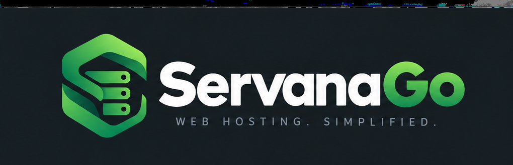

<p align="center">
  
</p>

# ServanaGo

A lightweight, self-hosted web runtime manager: a small Go app with a web UI, an embedded [Caddy](https://caddyserver.com), SQLite and (planned) systemd integration. Caddy's configuration is generated from SQLite and applied atomically.

> **Status: early.** Static sites, Node.js and PHP-FPM runtimes and systemd supervision of managed applications are on the [roadmap](docs/ROADMAP.md), not shipped. Nothing below describes planned features as working.

## What works today

- Certificates over HTTP-01/TLS-ALPN by default, one per host, with no DNS provider at all (ports 80 and 443 must be reachable from the internet).
- Optional Cloudflare: with an API token, certificates use ACME DNS-01 (no inbound ports needed for issuance, LAN-only upstreams work), a domain can have one wildcard certificate, and ServanaGo creates and removes the matching A records (DNS-only, never proxied), including the record for the UI host itself.
- Per-route enable/disable, CIDR allowlist, basic auth, streaming and upload limits, and an optional magic-link site gate.
- Admin login with optional authenticator app, backup codes, passkeys and Cloudflare Turnstile.
- Upstream health, certificate expiry, DNS state and a live Caddy/ACME log in the UI.
- Built-in help for people new to DNS and TLS: a hint under every field, a live preview of what *Add site* will create, plain-language explanations of errors and status words, a getting-started checklist and a Help page.
- A single static Go binary; all state in one data directory.

**Addresses.** An A record target (`SERVANAGO_HOST_IP`, a domain's default IP, a route's DNS record IP) can be any usable IPv4 address: public, private (10/8, 172.16/12, 192.168/16) or CGNAT (100.64/10, Tailscale). Loopback, link-local, multicast and reserved addresses are refused. **IPv6 is dual-stack:** an optional IPv6 address next to each IPv4 one (`SERVANAGO_HOST_IP6`, a domain's IPv6, a route's AAAA record IPv6) makes ServanaGo manage an AAAA record beside the A record, with its own state, conflict and take-over handling. The IPv4 address stays required, and an IPv6-only site is not supported. Cloudflare-proxied (orange cloud) records are not supported either.

**Without Cloudflare** (no `CLOUDFLARE_API_TOKEN`): add each domain on the *Domains* page before adding sites under it (ServanaGo cannot look up a zone), certificates are per host, and you point DNS at the server yourself. A site must be a single label under its domain (`app.example.com` under `example.com`) until the site model lands in M2.

## Install

Debian 12+ or Ubuntu 22.04+ with systemd. One deb: the binary, a `servanago` system user, `/etc/servanago/servanago.env`, the `servanago.service` unit and `/var/lib/servanago` (`DATA_DIR`) plus `/var/log/servanago`.

```sh
make deb                                    # bin/servanago_0.1.0_amd64.deb
sudo apt-get install ./bin/servanago_0.1.0_amd64.deb
```

Or all of it with nothing but this checkout: `sudo packaging/install.sh`.

The unit is enabled but not started: fill in the env file first (`SERVANAGO_HOST`, `ACME_EMAIL`, `ADMIN_PASSWORD`), then `systemctl start servanago`. The env file is a conffile: dpkg keeps your edits across upgrades. Logs go to journald (`journalctl -u servanago`). Removing the package stops and disables the unit; purging it also removes the `servanago` user but keeps `/var/lib/servanago` until you delete it.

## Run it from source

There is no package or image yet. ServanaGo reads its configuration from the process environment only; it does not load `.env` itself.

1. Optional: create a Cloudflare API token (see below) if you want DNS-01 certificates and automatic A records.
2. Build the binary (Go and no other toolchain; no Node build step):

   ```sh
   make build        # bin/servanago
   ```
3. Copy the example environment file and fill it in:

   ```sh
   cp .env.example .env
   ```

   `SERVANAGO_HOST` and `ACME_EMAIL` are required, plus `SERVANAGO_HOST_IP` if you set `CLOUDFLARE_API_TOKEN`. Set `ADMIN_PASSWORD` too: it creates the first administrator on the first start.
4. Run it as an unprivileged user. Either let it bind 80 and 443 with a capability, or choose other ports:

   ```sh
   sudo setcap cap_net_bind_service=+ep bin/servanago        # then HTTP_PORT/HTTPS_PORT can stay default
   set -a; . ./.env; set +a
   DATA_DIR="$PWD/data" ./bin/servanago
   ```

   With a Cloudflare token, ServanaGo creates the `SERVANAGO_HOST` A record itself (pointing at `SERVANAGO_HOST_IP`). Without one, point `SERVANAGO_HOST` at this server in your own DNS first, because Let's Encrypt validates over HTTP-01.
5. Open `https://<SERVANAGO_HOST>`. With Cloudflare, the dashboard's *UI host* card shows the record's state. Click **Add site** and enter the hostname (`oc.example.com`; add more, one per line) and its backend: host or IP plus its own **Upstream port** field (`192.168.25.165` and `9200`), or switch the kind to **Static** and give a folder to serve. With Cloudflare, ServanaGo finds the zone, adds the domain if it is new, and creates the A record; a hostname Cloudflare has no zone for, or any hostname without Cloudflare, is served with its own HTTP-01 certificate and you point its DNS at the server yourself. That is the Caddyfile equivalent of `oc.example.com { reverse_proxy http://192.168.25.165:9200 }`.

If the zone for `SERVANAGO_HOST` can't be found, set `SERVANAGO_HOST_ZONE`. If a different A record already exists for that name, the card shows a conflict and a *Take over* button; nothing is overwritten until you click it. To try it without burning Let's Encrypt rate limits, set `ACME_STAGING=true`.

## Cloudflare token (optional)

Create a custom API token at *My Profile → API Tokens* with:

- `Zone : Zone : Read`
- `Zone : DNS : Edit`

scoped to the zones you want to manage. The same token is used for certificate issuance (DNS-01) and for the A records. It is read from the environment only; it is never stored in SQLite, logs or the generated Caddy config.

## Configuration

**Core**

| Variable | Required | Meaning |
|---|---|---|
| `SERVANAGO_HOST` | yes | Hostname the UI is served on. It gets its own certificate. |
| `ACME_EMAIL` | yes | Let's Encrypt contact; a bare address. |
| `ADMIN_PASSWORD` | no | Creates the first administrator (named by `ADMIN_USER`) on the first start, when no administrators exist yet. After that it is **ignored**: passwords live in the database and are changed in the UI. **Unset with no administrators means the UI is open** (warning in the log and a red banner). |
| `ADMIN_USER` | no | Name of that first administrator: lower-case letters, digits, `.`, `_`, `-`. Default `admin`. |
| `SERVANAGO_SECRET_KEY` | no | At least 32 characters (`openssl rand -hex 32`). Encrypts the authenticator-app seed and the SMTP password in SQLite, and signs magic-link sessions; without it those options are off. Back it up with the data directory: if it is lost, run `servanago 2fa-reset NAME` for each administrator. |
| `REQUIRE_2FA` | no | `true`: a password login must be followed by an authenticator code, and a password-only session is limited to the Security page until one is set up. Applies to every administrator. Needs `SERVANAGO_SECRET_KEY`. |
| `TURNSTILE_SITE_KEY`, `TURNSTILE_SECRET` | no | Both or neither. Adds a Cloudflare Turnstile check to the password form on `SERVANAGO_HOST`. The `UI_LISTEN` recovery address is exempt. Passkey and code steps have no widget. |
| `SERVANAGO_STATIC_ROOTS` | no | Colon-separated absolute prefixes that a static site's folder must sit under, such as `/srv/www:/home`. Unset allows any folder except `DATA_DIR`, `/etc`, `/proc`, `/sys`, `/dev`, `/root` and `/`. Symlinks are resolved before the check. ServanaGo never changes permissions: the user it runs as needs execute on the parent directories and read on the folder. |
| `ACME_ISSUER` | no | `internal` serves self-signed certificates from Caddy's local CA (offline setups and tests). Default is Let's Encrypt. |
| `ACME_STAGING` | no | `true` uses the Let's Encrypt staging CA. |
| `UI_LISTEN` | no | Default `127.0.0.1:8080`. |
| `DATA_DIR` | no | Default `/data`, a container-era default that changes with native packaging (M3). Set it explicitly. |
| `HTTP_PORT`, `HTTPS_PORT` | no | Caddy listen ports, default 80 and 443. |

**Cloudflare (optional).** Leave `CLOUDFLARE_API_TOKEN` unset to run without it. Set it to get DNS-01 certificates (wildcards available) and automatic A and AAAA records.

| Variable | Required | Meaning |
|---|---|---|
| `CLOUDFLARE_API_TOKEN` | no | Token above. Unset: no DNS management, per-host HTTP-01 certificates. Set: DNS-01 certificates and record sync. A malformed token is rejected at startup. |
| `SERVANAGO_HOST_IP` | with a token | Address `SERVANAGO_HOST` resolves to; ServanaGo creates and syncs that A record. Any usable IPv4 address (public, private or Tailscale); the same rule applies to every domain and route IP. |
| `SERVANAGO_HOST_IP6` | no | Optional IPv6 address of `SERVANAGO_HOST`; ServanaGo also creates and syncs an AAAA record for it. A global unicast or unique-local address; the IPv4 address above is still required. |
| `SERVANAGO_HOST_ZONE` | no | Cloudflare zone name for that record. Unset walks up the host's labels. |
| `ACME_RESOLVERS` | no | Resolvers for the DNS-01 check. Default `1.1.1.1,8.8.8.8`. |
| `ACME_PROPAGATION_DELAY`, `ACME_PROPAGATION_TIMEOUT` | no | DNS-01 tuning, e.g. `2m` / `10m`. Unset uses Caddy's defaults. |

## Warnings

**`UI_LISTEN` is a recovery hatch, not a default.** The UI listens on loopback and Caddy proxies `SERVANAGO_HOST` to it. If Caddy is broken you can set `UI_LISTEN=0.0.0.0:8080` to fix things, but then the UI is reachable without TLS. With no administrators that is a full authentication bypass. Remove it again afterwards.

**Administrators.** Everyone who can sign in is an administrator with the same powers; there are no roles. The **Users** page adds and removes administrators, sets their passwords and resets their second factor if they lose it. Each of those asks for your own password again (and a code, if you use an authenticator), ends the other person's open sessions, and cannot be done to yourself or to the last administrator. Every action is recorded on the **Audit** page (who, what, target, client address; never a password or code). If every administrator is locked out, run `servanago user passwd NAME` (or `user add NAME`) on the server; it reads only `DATA_DIR`.

**Two-factor and passkeys.** Once an administrator exists, the Security page adds an authenticator app (with 10 one-time backup codes) and passkeys, for the signed-in administrator only. A passkey sign-in skips the code. Passkeys work on `https://SERVANAGO_HOST` and on `localhost`, and are tied to that hostname: changing `SERVANAGO_HOST` makes existing ones unusable. Lost an authenticator and passkeys? Another administrator can reset them on the Users page, or on the server run `servanago 2fa-reset NAME` (it needs only `DATA_DIR`); it removes that person's authenticator, backup codes and passkeys and ends their sessions.

**Magic-link site access.** A site's form (add and edit) can require a magic link before it is served: either an allowlist of addresses and `@domains`, or open to any address. The link is sent by email, single-use, 15 minutes. Email delivery is configured once under **Settings** (SMTP host, port, user, MAIL FROM; an optional password is stored encrypted, which needs `SERVANAGO_SECRET_KEY`). Sessions are shared across the gated sites that allow that address and slide 30 days (allowlist) or 7 days (open) while in use; revoking one identity under Security cuts it on every gated site at once. This is an access barrier for staging sites, not full authentication: a site that needs real auth must do its own.

**Data directory permissions.** The user running ServanaGo must be able to write `DATA_DIR` (the database and Caddy's certificate storage). Keep it private to that user.

**Backups.** Copy `DATA_DIR` (SQLite database and Caddy's certificate storage).

## How it works

Every change writes SQLite, renders the full Caddy JSON, and loads it with `caddy.Load`. If Caddy rejects it, the database change is rolled back, the previous configuration stays live, and the UI shows Caddy's exact error. If the stored configuration fails to load at startup, ServanaGo serves a bootstrap configuration (the UI only) and shows a banner instead of crash-looping.

Cloudflare records ServanaGo creates are marked `managed by servanago` and are the only ones it will change or delete. An identical existing record is adopted and never touched; a different one is reported as a conflict, with an explicit *Take over* action. The same rules apply to the UI host's record, which is synced at startup and from the dashboard, and never deleted automatically.

A route's A record points at its domain's default IP unless the route sets its own *DNS record IP*. A DNS failure never reverts a route: the dashboard shows the error with a *Retry* button.

A route can't use the hostname of `SERVANAGO_HOST`, since the UI route always wins in Caddy.

## Development

```sh
make test    # go test -race ./cmd/... ./internal/...
make lint    # gofmt + golangci-lint
make e2e     # Playwright against the built binary (bun + chromium)
make check   # all of the above
make build   # static binary in bin/
```

The roadmap and the decisions behind it are in [`docs/ROADMAP.md`](docs/ROADMAP.md). The inherited baseline's design notes are in `docs/DESIGN.md` and its requirements in `docs/REQUIREMENTS.md`; both predate the roadmap and are being reworked milestone by milestone. Brand asset provenance is in `docs/brand/README.md`.

## License

MIT, see `LICENSE`. Third-party notices (Caddy, caddy-dns/cloudflare: Apache-2.0, and others) are in `NOTICE`.
