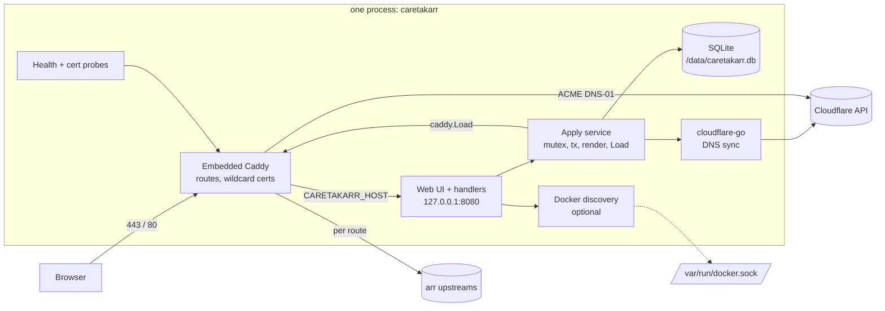
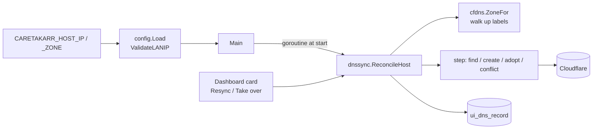

# Caretakarr — Architecture

Status: draft from `/sc:design`. Inputs: `docs/REQUIREMENTS.md`. Next: `/sc:workflow` to produce `IMPLEMENTATION_PLAN.md`.

## 1. Decisions closing the requirements' open questions

| Question | Decision |
|---|---|
| A-record IP | Per-domain default IP, user-entered, overridable per route. No auto-detect. |
| Orange cloud | Not supported. Records are always DNS-only (`proxied=false`). |
| DNS on route delete | Delete only records Caretakarr created (`owned=1`). Adopted records are never modified or deleted. |
| ACME CA | `ACME_STAGING` env. Default production. Dev compose file sets it `true`. Read-only in UI. |
| Import/export | Out of v1. `/data/caretakarr.db` copy is the backup. |
| UI hostname cert | `CARETAKARR_HOST` always gets its own exact-name cert policy, independent of the DB. It does not need to be a managed domain. |

## 2. Verified facts the design relies on

- `caddy.Load(cfgJSON []byte, forceReload bool) error` swaps config atomically, restores the old one on failure, installs no signal handler. We own signals. (Source: `caddy.go`, high confidence.)
- `caddy.Load` autosaves unless `admin.config.persist=false`. We set it false, since SQLite is the source of truth. Verify field names in the spike.
- Caddy 2.10+ serves matching subdomains from one wildcard cert.
- Websocket and `X-Forwarded-*` handling is automatic in `reverse_proxy`.
- `cloudflare-go` latest major is **v7** (`github.com/cloudflare/cloudflare-go/v7`, v7.13.0 on 2026-10-12). Context7's v4.5.1 listing is stale. `option.WithBaseURL` lets tests point it at `httptest`, so no DNS interface is needed.
- `caddy-dns/cloudflare` token: `Zone:Read` + `DNS:Edit`. The same token drives `cloudflare-go`, so one token serves both.

## 3. Components



The UI listens only on loopback. Caddy proxies `CARETAKARR_HOST` to it, so the UI gets the same TLS as everything else. Optional `UI_LISTEN` (default `127.0.0.1:8080`) can be set to `0.0.0.0:8080` and published for recovery when Caddy is broken. Document this as an auth bypass if `ADMIN_PASSWORD` is unset.

### Package layout

```
cmd/caretakarr/main.go        wiring, signals, graceful shutdown
internal/config/              env parsing + validation (fail fast)
internal/store/               modernc.org/sqlite, embedded SQL migrations, queries
internal/caddycfg/            pure func: (State, Options) -> []byte JSON
internal/apply/               mutex + tx + render + caddy.Load + DNS reconcile
internal/cfdns/               zone lookup, A record upsert/delete/adopt
internal/web/                 handlers, templates/, static/ (embed.FS), auth, CSRF
internal/presets/             static slice of arr services + default ports
internal/discovery/           Docker /containers/json over unix socket (stdlib)
internal/probe/               TCP upstream check, loopback TLS cert probe
```

Choices: `modernc.org/sqlite` is pure Go, so `CGO_ENABLED=0` gives a static, multi-arch binary with no toolchain pain. Docker discovery uses stdlib HTTP over the unix socket, which avoids the moby client dependency tree.

## 4. Data model

```sql
CREATE TABLE domains (
  id         INTEGER PRIMARY KEY,
  name       TEXT NOT NULL UNIQUE,         -- example.com
  zone_id    TEXT NOT NULL,                -- Cloudflare zone, resolved on add
  default_ip TEXT NOT NULL,                -- A-record target
  cert_mode  TEXT NOT NULL DEFAULT 'wildcard' CHECK (cert_mode IN ('wildcard','per_host')),
  created_at TEXT NOT NULL DEFAULT CURRENT_TIMESTAMP
);

CREATE TABLE routes (
  id              INTEGER PRIMARY KEY,
  domain_id       INTEGER NOT NULL REFERENCES domains(id) ON DELETE RESTRICT,
  subdomain       TEXT NOT NULL,           -- sonarr
  scheme          TEXT NOT NULL DEFAULT 'http' CHECK (scheme IN ('http','https')),
  upstream_host   TEXT NOT NULL,
  upstream_port   INTEGER NOT NULL CHECK (upstream_port BETWEEN 1 AND 65535),
  tls_skip_verify INTEGER NOT NULL DEFAULT 0,
  enabled         INTEGER NOT NULL DEFAULT 1,
  record_ip       TEXT,                    -- NULL = domain default_ip
  allowlist       TEXT NOT NULL DEFAULT '',-- newline-separated CIDRs, '' = open
  basic_user      TEXT,
  basic_hash      TEXT,                    -- bcrypt; both NULL = no auth
  preset          TEXT,
  UNIQUE (domain_id, subdomain)
);

CREATE TABLE dns_records (
  route_id     INTEGER PRIMARY KEY REFERENCES routes(id) ON DELETE CASCADE,
  cf_record_id TEXT,
  content      TEXT,                       -- IP last synced
  owned        INTEGER NOT NULL DEFAULT 1, -- 0 = adopted, never touch
  state        TEXT NOT NULL DEFAULT 'pending' CHECK (state IN ('pending','synced','error','conflict')),
  error        TEXT,
  synced_at    TEXT
);
```

Migrations: `internal/store/migrations/NNN_name.sql` embedded, applied in order, tracked with `PRAGMA user_version`. No migration library. Open DB with WAL, `foreign_keys=ON`, `busy_timeout`.

Secrets never stored: no CF token, no admin password. Basic-auth stores only a bcrypt hash.

## 5. Caddy config generation

`caddycfg.Render(state State, opts Options) ([]byte, error)` is pure and golden-file tested. `Options{UIHost, UIUpstream, Email, Staging, HTTPPort, HTTPSPort, StoragePath, Issuer}` where `Issuer` is `ACME` (prod/staging) or `Internal` (tests only).

```jsonc
{
  "admin": { "disabled": true, "config": { "persist": false } },
  "storage": { "module": "file_system", "root": "/data/caddy" },
  "apps": {
    "http": {
      "http_port": 80, "https_port": 443,
      "servers": { "srv0": {
        "listen": [":443"],
        "routes": [
          // 1. UI route (always present, first)
          { "match": [{"host": ["caretakarr.example.com"]}],
            "handle": [{"handler":"reverse_proxy","upstreams":[{"dial":"127.0.0.1:8080"}]}],
            "terminal": true },
          // 2. one per route
          { "match": [{"host": ["sonarr.example.com"]}],
            "handle": [{ "handler": "subroute", "routes": [
              { "match": [{"not":[{"remote_ip":{"ranges":["192.168.0.0/16"]}}]}],
                "handle": [{"handler":"static_response","status_code":"403"}], "terminal": true },
              { "handle": [{"handler":"authentication","providers":{"http_basic":{
                  "hash":{"algorithm":"bcrypt"},
                  "accounts":[{"username":"u","password":"$2a$..."}]}}}] },
              { "handle": [{"handler":"reverse_proxy","upstreams":[{"dial":"192.168.1.20:8989"}],
                  "transport":{"protocol":"http"}}] }
            ]}], "terminal": true }
        ]
      }}
    },
    "tls": { "automation": { "policies": [
      { "subjects": ["*.example.com"], "issuers": [ACME_ISSUER] },
      { "subjects": ["caretakarr.example.com"], "issuers": [ACME_ISSUER] }
    ]}}
  }
}
```

`ACME_ISSUER`:
```jsonc
{ "module": "acme", "email": "<ACME_EMAIL>", "ca": "<staging URL, omitted for prod>",
  "challenges": { "dns": {
    "provider": { "name": "cloudflare", "api_token": "{env.CLOUDFLARE_API_TOKEN}" },
    "propagation_delay": "<ACME_PROPAGATION_DELAY, omitted if unset>",
    "propagation_timeout": "<ACME_PROPAGATION_TIMEOUT, omitted if unset>",
    "resolvers": ["1.1.1.1", "8.8.8.8"] } } }
```

This is the JSON equivalent of the homelab Caddyfile's `tls { dns cloudflare {$CLOUDFLARE_API_TOKEN}; propagation_timeout 10m; propagation_delay 2m; resolvers 1.1.1.1 8.8.8.8 }`. `propagation_delay` and `propagation_timeout` are optional: emitted only if `ACME_PROPAGATION_DELAY` / `ACME_PROPAGATION_TIMEOUT` are set (the homelab values were `2m` / `10m`). `resolvers` comes from `ACME_RESOLVERS`, default `1.1.1.1,8.8.8.8`. The `{$VAR}` form in a Caddyfile is substituted at parse time. The JSON `{env.VAR}` placeholder is resolved at runtime, so the rendered JSON never contains the token. Field names `propagation_delay`, `propagation_timeout`, `resolvers` sit on `challenges.dns` (confirmed in Caddy's ACME issuer JSON reference: `challenges.dns` = `provider`, `ttl`, `propagation_delay`, `propagation_timeout`, `resolvers`, `override_domain`). Caddy defaults when omitted: timeout 2 minutes, delay 0. `email` sits on the `acme` issuer next to `ca`; it comes from the required `ACME_EMAIL`.

Cert mode, per domain (`domains.cert_mode`):
- `wildcard` (default): TLS policy `subjects: ["*.example.com"]`. One issuance per domain, so adding routes costs none, and subdomain names stay out of CT logs.
- `per_host`: TLS policy `subjects` lists that domain's enabled and disabled route hostnames (`["banking.example.com", …]`), matching the plain Caddyfile behavior. Each new route triggers a new issuance and pays any configured propagation delay.
- Empty `per_host` domain (no routes) emits no policy. Hostnames are sorted for deterministic output.

Migration check for the homelab case: `banking.example.com` → domain `example.com`, route `banking`, upstream `192.168.25.165:8766` over `http`. The renderer must produce the same behavior as that Caddyfile (golden test).

Rules:
- The token is the placeholder `{env.CLOUDFLARE_API_TOKEN}`, never the literal, so rendered JSON is safe to log.
- Disabled route: `static_response` 503 with a short body, instead of removing the route. Keeps cert and DNS meaningful.
- Order: UI route first, then routes by subdomain (deterministic output for golden tests and for `Load`'s same-config short-circuit).
- Both `http_port`/`https_port` come from `Options`, so integration tests use high ports.
- Tests use `Issuer=Internal` (`{"module":"internal"}`) plus `pki.certificate_authorities.local.install_trust=false`. No real ACME or Cloudflare in tests.
- Zone names ending `.local`, `.internal`, `.home.arpa`, and IP literals are rejected at domain-add (validated in `internal/config` helper, tested).

## 6. Apply path (the only way config changes)

```mermaid
sequenceDiagram
  participant H as web handler
  participant A as apply (global mutex)
  participant S as SQLite tx
  participant C as caddy.Load
  participant D as cfdns
  H->>A: Mutate(fn)
  A->>S: BEGIN, fn(tx)
  A->>A: state = read(tx); json = Render(state)
  A->>C: Load(json, false)
  alt Caddy rejects
    C-->>A: error
    A->>S: ROLLBACK
    A-->>H: error (exact text, shown in UI)
  else ok
    A->>S: COMMIT
    A->>D: Reconcile(routes needing DNS)
    D-->>A: per-route state (synced / error / conflict)
    A->>S: update dns_records
    A-->>H: ok + DNS states
  end
```

- `// ponytail: global mutex; per-domain locks if concurrent admin edits ever matter.`
- DNS is not transactional with SQLite. A DNS failure does not revert the route. The route works if the record exists, and `dns_records.state='error'` shows a retry button.
- Startup: render from DB and `Load`. If that fails, load the **bootstrap-only config** (UI route + UI cert policy) and show a persistent banner with the error, so the user can fix data from the UI.
- Commit failing after a successful `Load` is rare. Handle by re-rendering from the DB and `Load`ing again, then returning the error.

## 7. DNS sync (`cfdns`, `cloudflare-go/v7`)

- Domain add: `Zones.List(name=…)` → `zone_id`. Failure means token lacks access or zone not in account: reject with that message.
- Startup: verify token (`User.Tokens.Verify`). Bad token → UI banner, no crash.
- Reconcile one route: name = `sub.domain`, content = `record_ip ?? default_ip`.
  - No stored record id: `DNS.Records.List(type=A,name=…)`.
    - none → create (`proxied=false`, `comment="managed by caretakarr"`), `owned=1`.
    - exists, same content → adopt, `owned=0`, `state=synced`.
    - exists, different content → `state=conflict`, no write, UI offers "Take over" (updates and sets `owned=1`).
  - Stored id, content changed → update (only if `owned=1`).
- Delete route: if `owned=1` delete the record, else leave it. Always confirm in UI and say which.
- No periodic drift detection in v1. A "Resync" button covers it.

## 8. Web layer

- stdlib `net/http` with Go 1.22+ `ServeMux` patterns. `html/template` pages and partials, htmx swaps. Assets in `embed.FS`. Pico CSS vendored, no CDN at runtime.
- Pages: `/` dashboard (domains, routes, status), `/domains`, `/routes/new`, `/routes/{id}`, `/login`, `/status` (health fragment, polled every 10s with htmx).
- Auth (if `ADMIN_PASSWORD` set): constant-time compare, signed session cookie (`HttpOnly`, `Secure`, `SameSite=Strict`, 12h), key generated per boot (restart logs everyone out; fine). In-memory per-IP login throttle.
- CSRF: `SameSite=Strict` plus reject non-GET without `HX-Request` or with a mismatched `Origin`.
- Unset password: all requests pass, a startup `WARN` log, and a red dashboard banner.
- Client IP for throttling comes from `X-Forwarded-For` only when the peer is loopback (i.e. from Caddy).
- Upstream form: preset dropdown fills subdomain and port. Docker discovery panel appears only if the socket exists.

## 9. Status and probes

- **Upstream health:** TCP dial every 30s per enabled route, kept in memory, shown as up/down.
- **Cert state:** loopback TLS dial to `127.0.0.1:443` with SNI = route host, `InsecureSkipVerify`, read leaf `NotAfter` and issuer. Handshake failure → "pending/error". Tests the real serving path with no Caddy internals.
- **Logs (v1):** ACME failure reasons live in Caddy logs, so a registered Caddy log writer module (`caddy.logging.writers.caretakarr`) feeds an in-memory ring buffer (e.g. 1000 lines) shown on a Logs page, filterable by level, polled by htmx. Config adds a `logging.logs.default` with that writer. This prevents the "pending forever" dead end. Not persisted. 

Writer module shape (modeled on Caddy's built-in `caddy.logging.writers.file`/`stdout`):
```go
package caddylog

var Sink = NewRing(1000) // set up by main before caddy.Load; also read by the web layer

func init() { caddy.RegisterModule(Writer{}) }

type Writer struct{}

func (Writer) CaddyModule() caddy.ModuleInfo {
	return caddy.ModuleInfo{ID: "caddy.logging.writers.caretakarr", New: func() caddy.Module { return new(Writer) }}
}
func (Writer) String() string                      { return "caretakarr" }
func (Writer) WriterKey() string                   { return "caretakarr:ring" }  // constant: pooled, survives reloads
func (Writer) OpenWriter() (io.WriteCloser, error) { return nopCloser{Sink}, nil } // Close is a no-op, never closes the ring

var _ caddy.WriterOpener = (*Writer)(nil)
```
Rendered config: `"logging":{"logs":{"default":{"writer":{"output":"caretakarr"},"encoder":{"format":"json"},"level":"INFO"}}}`. The ring parses each JSON line, keeps `ts`, `level`, `logger`, `msg`, and the error field. `Write` must not block (mutex-guarded slice, drop oldest). Import the package for side effects in `main`. Spike acceptance: render config with this writer, `Load`, trigger an ACME failure (bad token against staging), see the line in `Sink`; reload twice and confirm the ring still receives lines.

Because `Sink` is a package global, tests that assert on log lines run serially along with the other Caddy integration tests.

## 10. Docker discovery (opt-in)

`GET http://unix/containers/json` over `/var/run/docker.sock`. Show name, image, exposed private ports, networks. Pre-fill route with the container name as the upstream host (resolvable only if on a shared user-defined network; the UI says so). Docs recommend a read-only socket proxy (e.g. `tecnativa/docker-socket-proxy`) instead of the raw socket.

## 11. Build and runtime

```
builder: golang:<ver>  CGO_ENABLED=0 go build -trimpath -ldflags="-s -w"
final:   gcr.io/distroless/static:nonroot  (has CA certs; UID 65532)
/data volume; ports 80, 443, 443/udp (HTTP/3)
```

- Non-root can bind 80/443 because Docker ≥20.10 sets `ip_unprivileged_port_start=0`. Document that `/data` must be writable by UID 65532.
- `docker-compose.yml`: caretakarr service, `./data:/data`, `.env`. Optional commented socket mount. `docker-compose.dev.yml` sets `ACME_STAGING=true`.
- Module path `github.com/caretakarr/caretakarr`. GitHub Actions: `make check`, then multi-arch (amd64, arm64) image build to `ghcr.io/caretakarr/caretakarr` on tag.
- Dependencies (`caddyserver/caddy/v2`, `caddy-dns/cloudflare`, `cloudflare-go/v7`) pinned in `go.mod` at the latest stable tags when slice 0 starts. Renovate or Dependabot bumps afterward.
- Ship `LICENSE` (MIT) and `NOTICE` (Caddy, caddy-dns/cloudflare: Apache-2.0).

## 12. Test strategy per component

| Component | Layer | Approach |
|---|---|---|
| `caddycfg` | unit | Golden JSON for: empty DB (bootstrap), one route, disabled, allowlist, basic auth, staging vs prod issuer, wildcard vs per_host, delay/timeout set vs unset, the `banking.example.com` homelab case |
| `store` | unit | In-memory SQLite, migrations apply cleanly, constraints (unique, port range) |
| `config` | unit | Env parsing, rejects bad hostnames and `.local`-style domains |
| `cfdns` | unit | `httptest` server + `WithBaseURL`: create, adopt, conflict, owned-delete, adopted-no-delete |
| `apply` | integration | Real in-process Caddy on high ports, `Issuer=Internal`, `httptest` upstream: route works, bad config rolls back DB and keeps old route live, websocket upgrade passes |
| `web` | unit + e2e | Handler tests for auth/CSRF/throttle; Playwright for add-domain, add-route-from-preset, toggle, delete-with-confirm |
| startup | integration | Corrupt route row → bootstrap-only fallback + banner |

Caveat: embedded Caddy is process-global (`caddy.Load` uses package state). Integration tests must run serially and call `caddy.Stop()` in cleanup.

## 13. Risks and mitigations

| Risk | Level | Mitigation |
|---|---|---|
| Process-global Caddy state in tests | moderate | Serial integration package, `caddy.Stop()` cleanup |
| `admin.disabled` / `config.persist` field names | low | Spike confirms against current Caddy before slice 1 |
| Config in DB makes Caddy unable to start | moderate | Bootstrap fallback (§6) |
| Open UI footgun | moderate | Warning log + red banner; document `ADMIN_PASSWORD` |
| Docker socket = host root | high if enabled | Opt-in, docs push socket proxy |
| Wildcard issuance slow or failing silently | moderate | Cert probe and Logs page (§9) |
| Custom Caddy log writer module registration | low | Spike confirms; fallback is `docker logs` |
| `modernc.org/sqlite` perf | low | Workload is a few rows |

## 14. Suggested slices (for `/sc:workflow`)

0. **Spike:** embed Caddy, `Load` a static JSON with `internal` issuer, curl a route, confirm admin disabled and persist off. Throwaway test becomes the integration harness.
1. `config` + `store` + migrations.
2. `caddycfg` renderer with bootstrap config (golden tests).
3. `apply` service + real-Caddy integration test (UI host route).
4. Web skeleton: layout, auth, CSRF, dashboard.
5. Domains: Cloudflare zone lookup (`cfdns` part 1).
6. Routes + presets + apply; website routing works end to end.
7. DNS record sync (create / adopt / conflict / owned delete).
8. Route controls: toggle, allowlist, basic auth.
9. Probes and status UI.
10. Docker discovery (opt-in).
11. Caddy log ring buffer + Logs page.
12. Dockerfile, compose, CI, docs, license/NOTICE.

## 15. Explicit non-goals (v1)

Orange-cloud records, DDNS/public-IP detection, multi-user accounts, path-based routing, import/export, `trusted_proxies` configuration, drift detection loop, non-Cloudflare DNS providers, public-IP records, IPv6/AAAA.

## 16. UI host record and LAN-only IPs

Source: brainstorm of 2026-10-14. Servers with several addresses need `CARETAKARR_HOST` to resolve to a chosen one, so Caretakarr manages that A record itself. Issuance is unaffected (DNS-01 needs no IP) and Caddy keeps listening on all interfaces.

### 16.1 Decisions
| Topic | Decision |
|---|---|
| `CARETAKARR_HOST_IP` | Required. IPv4 in 10/8, 172.16/12, 192.168/16 or 100.64/10 (CGNAT, Tailscale). Anything else fails startup naming the variable. |
| `CARETAKARR_HOST_ZONE` | Optional zone name override. Unset: walk labels up from the host, never below two labels, first zone the token can see. |
| Same rule everywhere | Domain `default_ip` and route `record_ip` use the same validator. Public IPs are out of scope for the whole product. |
| Record lifecycle | Same owned / adopt / conflict rules as routes. Reconciled in the background at each start and from dashboard buttons. Never deleted automatically. |
| Collision | A route whose `subdomain.domain` equals `CARETAKARR_HOST` is rejected (the UI route always wins in Caddy, so it could never be served). |

### 16.2 Components


- `config.ValidateLANIP(s) (netip.Addr, error)`: `Is4()` and (`IsPrivate()` or inside `100.64.0.0/10`). The error names the value and lists the allowed ranges. Test table covers every range boundary (`172.15.255.255` no, `172.16.0.0` yes, `172.31.255.255` yes, `172.32.0.0` no, `100.63.255.255` no, `100.64.0.0` yes, `100.127.255.255` yes, `100.128.0.0` no), loopback, link-local, unspecified, multicast, public, IPv6.
- Call sites: `config.Load` (host IP), `addDomain` (replaces the current `Is4` check), and `parseRoute` for a new `record_ip` form field. That field has no UI today, and the edit handler comment already says the override is "edited elsewhere"; this adds it to the route form and overlays it in `updateRoute`.
- `cfdns.ZoneFor(ctx, host, override) (zoneID, zoneName string, err)`. `ZoneID` gains a sentinel `ErrZoneNotFound`, so the walk continues only on not-found and aborts on API errors (bad token). Final error lists the names tried.
- `dnssync.step` is reused unchanged. `ReconcileHost(ctx, takeOver bool)` resolves the zone, builds `name = CARETAKARR_HOST`, `want = CARETAKARR_HOST_IP`, runs `step` with the stored row, and upserts. Failures become `state=error`, never a returned error and never fatal, matching routes. `Syncer` receives `HostSpec{Name, IP, ZoneOverride}` at construction.
- `ReconcileHost` runs in a goroutine in `main` next to `VerifyToken`, so startup and the bootstrap fallback never wait on Cloudflare.

### 16.3 Data
Migration `002_ui_dns.sql`. A route-independent twin of `dns_records`, constrained to one row:
```sql
CREATE TABLE ui_dns_record (
  id           INTEGER PRIMARY KEY CHECK (id = 1),
  cf_record_id TEXT,
  content      TEXT,
  owned        INTEGER NOT NULL DEFAULT 1,
  state        TEXT NOT NULL DEFAULT 'pending' CHECK (state IN ('pending','synced','error','conflict')),
  error        TEXT,
  synced_at    TEXT
);
```
Store gets `GetUIDNS` / `UpsertUIDNS` reusing the `DNSRecord` struct (`RouteID` unused). The zone is re-resolved on every reconcile, so it is not stored. Chosen over making `dns_records.route_id` nullable: that would weaken the FK and cascade that routes rely on.

### 16.4 Web
- Dashboard card above the routes table: host, IP, state, error text, and Resync / Take over buttons (same states and wording as route rows).
- `POST /host/dns/resync`, `POST /host/dns/takeover`, both CSRF-guarded and behind login, answering `HX-Redirect: /`.
- `checkRoute` (inside the apply tx) rejects `subdomain + "." + domain.Name == cfg.Host` with 422 and a clear message.

### 16.5 Edge cases
- Host under an unmanaged zone: works, since the zone comes from Cloudflare, not from the domains table.
- Host's zone is also a managed domain: routes there are unaffected apart from the collision rule.
- Token lacks the zone: state `error` with the tried names; the UI still serves from the bootstrap/normal config.
- Existing rows with public IPs (none expected): no crash. Reconcile does not re-validate stored rows; the dashboard may show a notice.
- Owned record, IP changed in env, restart: updated. Adopted record: becomes `conflict`, never written.

### 16.6 Test plan
| Layer | Cases |
|---|---|
| `config` | `ValidateLANIP` boundary table; `CARETAKARR_HOST_IP` missing / public / IPv6 fails naming the variable; `CARETAKARR_HOST_ZONE` must be a suffix of the host |
| `cfdns` | `ZoneFor`: found at each level, none found lists tried names, override used verbatim, API error aborts the walk |
| `dnssync` | host record: create, adopt, conflict then take over, IP change on owned, adopted untouched, API error, idempotent resync, zone not found |
| `store` | migration 002 on fresh and v1 DBs; one-row constraint |
| `web` | card renders each state; resync and take over endpoints; collision rejection; `record_ip` accepted/rejected; domain add rejects public IP |
| e2e | card shows synced; seeded conflict taken over; route named like the host is rejected |

### 16.7 Risks
| Risk | Level | Mitigation |
|---|---|---|
| A later need for public-IP records | low, accepted | The validator is one function; a switch would be additive |
| Zone walk picks a parent zone the user did not intend | low | `CARETAKARR_HOST_ZONE` override; tried names shown on error |
| Behavioral change for domains/routes (public IPs now rejected) | low | No installs yet; error message lists allowed ranges |
